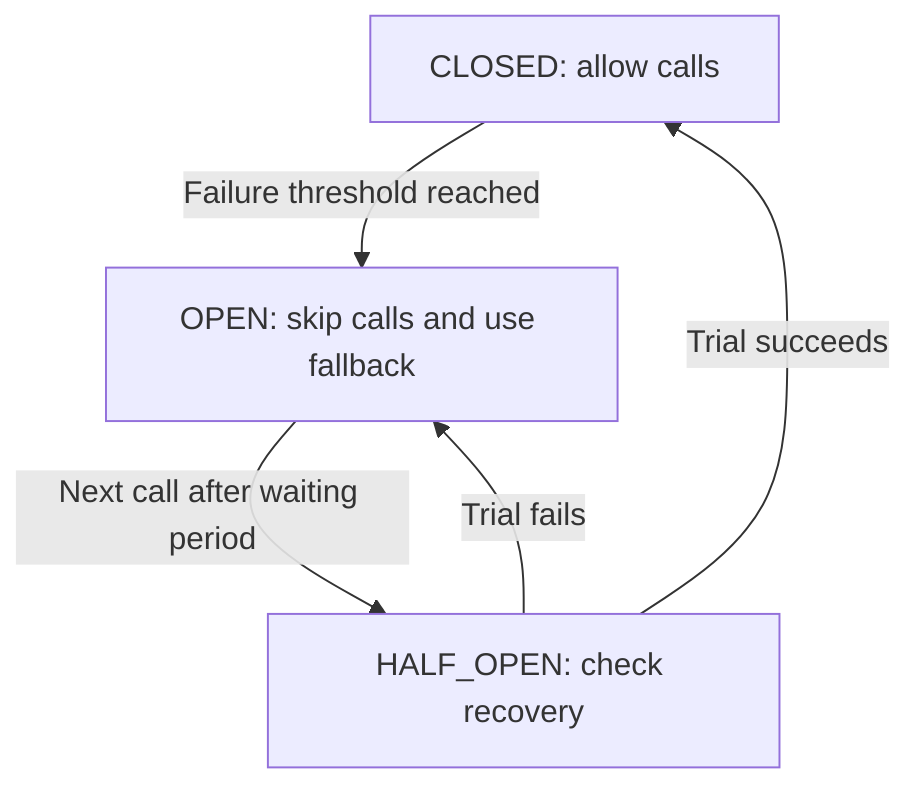
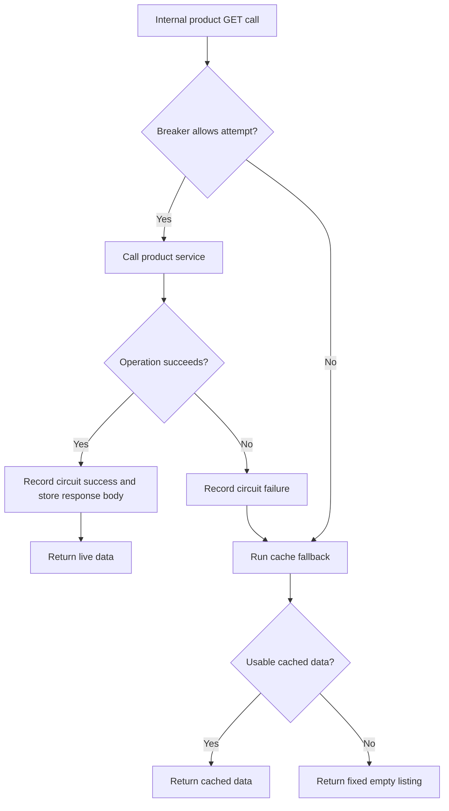

# Understanding circuit breakers, fallbacks, and caching

Created: 2026-11-05
Updated: 2026-11-05

This learning guide explains the concepts first, then connects them to this
gateway. For exact registrations, options, and limitations, see the
[internal proxy resilience guide](implementation/proxy-resilience.md).

## Why use a circuit breaker?

Imagine the gateway calls a product service that has stopped responding. Each
new request waits for a timeout, holding connections and other resources while
waiting for a result that is unlikely to arrive. Repeated calls also add load to
a service that may already be struggling to recover.

A circuit breaker remembers recent failures and temporarily stops making calls
to that dependency. Requests can then fail quickly or use an alternative response.
After a waiting period, the breaker allows work through to check for recovery.
It helps contain a dependency failure; it does not repair the dependency.

The name comes from an electrical circuit breaker: a closed circuit lets current
flow, while an open circuit interrupts it. In software, the flow being controlled
is calls to a dependency.

## The three states

| State       | Meaning                                                   | What happens to a new call?                                                       |
| ----------- | --------------------------------------------------------- | --------------------------------------------------------------------------------- |
| `CLOSED`    | Normal operation; calls are allowed.                      | Call the dependency and record success or failure.                                |
| `OPEN`      | The failure threshold has been reached.                   | Skip the dependency and use a fallback or return an error.                        |
| `HALF_OPEN` | The waiting period has passed; recovery is being checked. | Allow a trial call, or a limited group of calls, depending on the implementation. |

This diagram shows a simplified model with one successful recovery call required
to close the circuit:

The circuit starts `CLOSED`. Successes and failures below the threshold leave it
`CLOSED`. Calls during the open waiting period leave it `OPEN` and use the
fallback. A failed half-open trial restarts that waiting period.

A failure can trigger a fallback even while the circuit remains `CLOSED`. Opening
changes whether later calls attempt the dependency at all. Also, a fallback
succeeding does not prove that the dependency recovered, so it should not be
confused with a successful recovery call.

Implementations choose how to count failures: consecutive failures, a failure
percentage within a time window, or another policy. They also choose which
failures matter. For example, a connection failure and a rejected password tell
us different things about a dependency's availability.

Half-open concurrency is another policy choice. A controlled implementation can
limit trial calls so a recovering service is not flooded immediately. The
current gateway helper does not limit concurrent half-open attempts.

## Timeout, retry, and circuit breaker

These mechanisms answer different questions and can be combined:

| Mechanism       | Question it answers                                                   | Example                                                                  |
| --------------- | --------------------------------------------------------------------- | ------------------------------------------------------------------------ |
| Timeout         | How long may this attempt wait?                                       | Stop waiting for an HTTP response after 10 seconds.                      |
| Retry           | Should this operation be attempted again?                             | Retry a temporary connection failure if repeating the operation is safe. |
| Circuit breaker | Should a new attempt be allowed given previous failures?              | Skip calls for a period after repeated failures.                         |
| Fallback        | What should happen when the normal operation cannot provide a result? | Return suitable cached data, a default response, or an error.            |

A breaker still needs a way to bound slow operations, such as an HTTP timeout.
It does not automatically cancel calls already in progress. Retrying a payment
or another write can duplicate effects unless the operation has an appropriate
idempotency strategy. This project's breaker executes once per allowed call;
it does not implement retries.

## What is a fallback?

A fallback is an alternative behavior when the normal operation fails or is
skipped by an open circuit. It is often supplied as a function so it runs only
when needed.

For a product listing, a fallback might return previously fetched products or
an empty listing. For authentication, returning a fabricated successful login
would be incorrect; returning an explicit failure preserves the meaning of the
operation. A fallback may throw an error rather than return data.

The choice depends on the operation's contract. An empty listing can keep a page
usable, but it can also mislead a caller into thinking there are no products.
Applications may need a way to communicate that data is cached or unavailable.
That is a contract choice, not something a breaker supplies automatically.

## Where the cache fits

A cache stores a previous result so it can be reused. A cache used as a fallback
is consulted when the normal operation fails or the circuit blocks the call.
This differs from checking the cache before every outbound request to reduce
normal traffic.

The following diagram illustrates this project's internal product GET path.
“Usable cache” means present, within the configured maximum age, and truthy under
the current cache helper's check. The state diagram above explains when a call
is allowed; this diagram explains where its response comes from.

The diagram groups the successful steps for readability. In the code, the
operation stores its GET response before returning to the breaker, which then
records success.

A maximum age limits how old a stored result may be when reused. It does not
prove the result still matches the source: a product price could change a second
after it was cached. Cache keys must also distinguish every context that changes
the response, such as product filters or a verified user's identity when results
are personalized. Cached data must not cross an authorization boundary.

## A walk-through using this project's settings

Consider sequential calls to `proxyRequest` for a product listing. Assume a
successful earlier call stored a nonempty listing, then the product service
became unavailable. This is an example of the internal helper, not an exposed
HTTP route.

1. The first failed attempt increments the failure count to one. The circuit
   remains `CLOSED`, and the cache fallback returns the earlier listing if usable.
2. The second failed attempt increments the count to two and uses the fallback.
3. The third failed attempt reaches the proxy's threshold of three. The circuit
   becomes `OPEN`, starts a 30-second wait, and uses the fallback.
4. A call during that wait skips the product service and uses the fallback
   immediately. It does not wait for another outbound HTTP timeout.
5. The next call after the wait moves the circuit to `HALF_OPEN` and tries the
   product service. There is no background timer that sends a recovery request.
6. If the trial succeeds, the new listing is cached, the failure count resets,
   and the circuit becomes `CLOSED`. If it fails, the circuit opens again for
   another 30 seconds and the fallback runs.

In this example, each fallback uses cached data only while it meets the cache
helper's maximum-age check, which defaults to five minutes from the last write.
Once unavailable or expired, the product GET fallback returns
`{ products: [], total: 0, page: 1, limit: 10 }`. Returning that object does not
close the circuit or establish that the product service is healthy.

## How this maps to the repository

The responsibilities are split between injectable providers:

- [CircuitBreakerService](../src/common/circuit-breaker/circuit-breaker.service.ts)
  decides whether to attempt the operation, records outcomes, and invokes the
  supplied fallback when necessary.
- [ProxyService](../src/proxy/service/proxy.service.ts) supplies the outbound
  operation, chooses the service's fallback, and stores successful GET bodies.
- [CacheFallbackService](../src/common/fallback/cache.fallback.ts) stores data and
  creates a callback that selects cached data or a default.
- [DefaultFallbackService](../src/common/fallback/default.fallback.ts) creates
  callbacks that return defaults or throw errors. The proxy currently uses its
  error factory for operations other than product GETs.

These providers are wired together through
[ProxyModule](../src/proxy/proxy.module.ts). No controller currently calls
`proxyRequest`; login, registration, session validation, and health probes bypass
its circuit and fallback path.

The current implementation also has important boundaries: circuit/cache state is
local to one process, circuits are shared by service name, cache keys omit caller
identity and headers, and results do not indicate whether they came from a
fallback. The breaker's option named `timeout` does not enforce an operation
deadline; the outbound HTTP timeout does. Read the
[implementation guide](implementation/proxy-resilience.md) for the complete
mechanics and limitations, and [ADR 0007](ADR/0007-proxy-resilience.md) for the
recorded architecture and unresolved policy choices.
